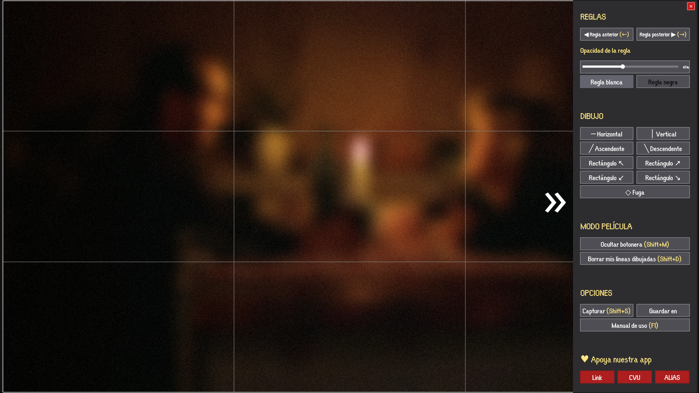
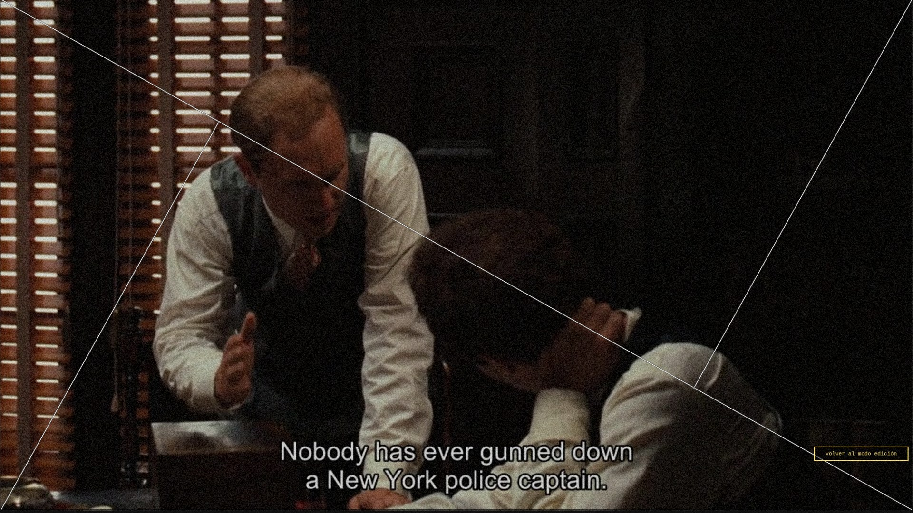
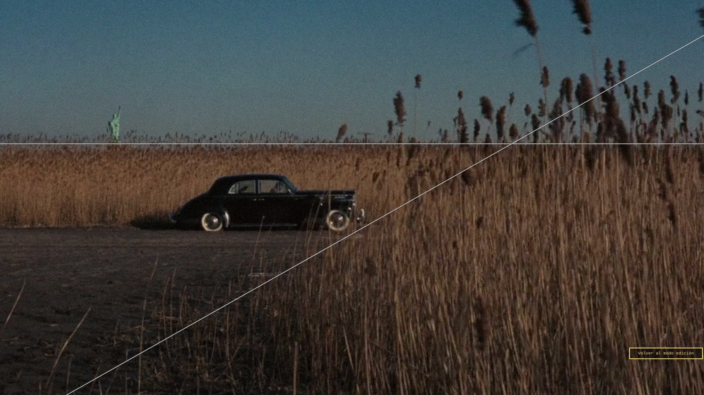
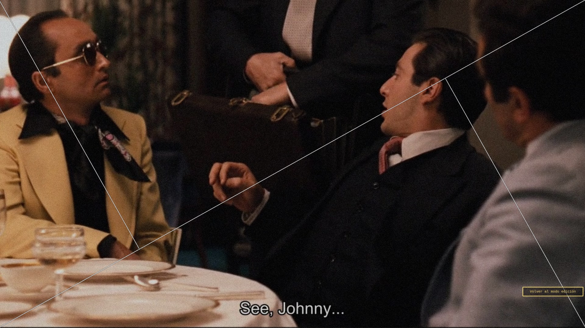
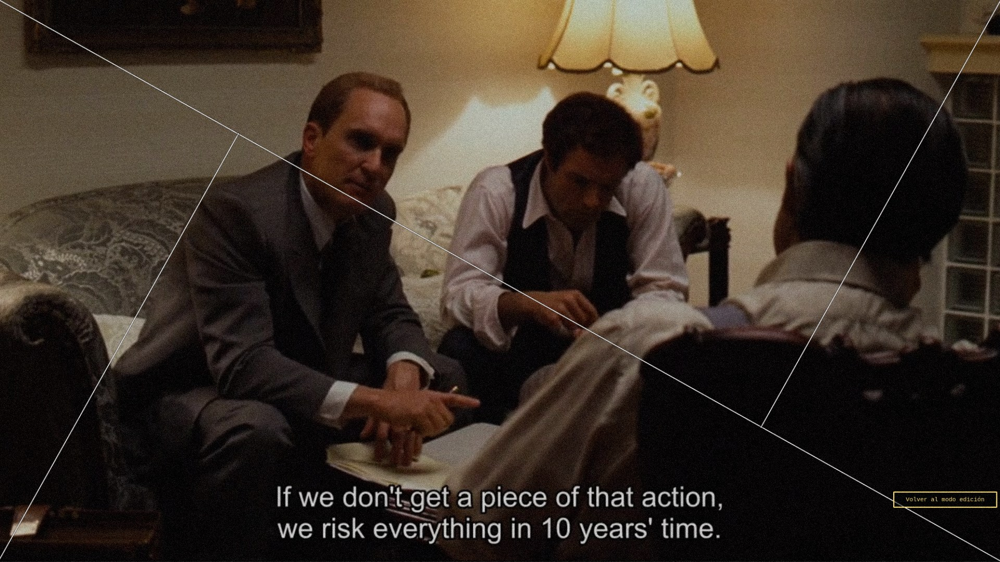

# ALEPH

**Reglas de composicion fotograficas transparentes para superponer en pantalla.
Útil para guiarte en tus animaciones y para estudiar la composición fotográfica de series, peliculas, fotografia y obras de arte.**



## Caracteristicas

- **11 guías preestablecidas**: regla de tercios, triángulos áureos,
  espirales de Fibonacci, centro, diagonales y rejilla áurea.
  Incluye un **espacio vacío** para trabajar solo con tus reglas.

- **Modo pasivo**: la ventana deja de capturar el ratón y los clics pasan al contenido de abajo.

- **Captura de pantalla con las guías y reglas superpuestas.**

## Galeria

Muestra de las guías de Aleph sobre **The Godfather**, en modo pasivo:

<table>
  <tr>
    <td width="50%"><a href="docs/aleph-01.jpg"></a></td>
    <td width="50%"><a href="docs/aleph-02.jpg"></a></td>
  </tr>
  <tr>
    <td width="50%"><a href="docs/aleph-03.jpg"></a></td>
    <td width="50%"><a href="docs/aleph-04.jpg"></a></td>
  </tr>
  <tr>
    <td width="50%"><a href="docs/aleph-05.jpg"></a></td>
    <td width="50%"><a href="docs/aleph-06.jpg"></a></td>
  </tr>
  <tr>
    <td width="50%"><a href="docs/aleph-07.jpg"></a></td>
    <td width="50%"><a href="docs/aleph-08.jpg"></a></td>
  </tr>
  <tr>
    <td width="50%"><a href="docs/aleph-09.jpg"></a></td>
    <td width="50%"><a href="docs/aleph-10.jpg"></a></td>
  </tr>
</table>

## INSTALACIÓN

Descargá el binario de tu sistema desde la pestaña [Releases](https://github.com/LucasLassa/aleph/releases) del
repositorio, o desde este link <https://github.com/LucasLassa/aleph/releases>

- **Linux x86_64**
- **Windows x86_64**

En **Linux**, dale permisos de ejecución con `chmod +x`.
En **Window**s, **"Ejecutar de todas formas"** (SmartScreen).

### Desde el código
Requisitos:

- **Python ≥ 3.11**
- **PySide6 ≥ 6.5**

Instalación recomendada:

```bash
python -m venv .venv
source .venv/bin/activate
pip install -e .[dev]
aleph
```

En entornos con PEP 668, si preferís instalar en el usuario:

```bash
pip install --user --break-system-packages -e .[dev]
aleph
```

También podés correrlo sin instalar:

```bash
python -m src.main
```

## Uso rápido

La ventana se abre a pantalla completa, adaptada al monitor, con el
marco activo.

### Atajos

| Tecla | Acción |
|---|---|
| `←` / `→` | Guía anterior / siguiente |
| `↑` / `↓` | Subir / bajar opacidad (pasos de 0.05) |
| `Shift + M` | Alternar modo marco (edición ↔ pasivo) |
| `Shift + D` | Borrar las reglas propias |
| `Shift + S` / `PrtScn` | Captura de pantalla con las líneas |
| `Shift + C` | Alternar color de las líneas (blanco / negro) |
| `F1` | Abrir / cerrar el manual |
| `Tab` | Abrir / cerrar el panel |
| `Clic izq.` | Con una regla armada, colocarla en el lienzo |
| `Shift + clic izq.` | Varias reglas seguidas / mover una existente |
| `Esc` | En cascada: cierra el manual → desarma la regla → cierra el panel → sale del modo película → cierra Aleph |

Las teclas se configuran en `src/core/keymap.py`.

### Panel lateral

Con el marco activo, se muestra un panel a la derecha que se despliega,
organizado en secciones:

- **Reglas**: guía anterior/posterior, opacidad y color de las líneas.
- **Dibujo**: botones para crear reglas propias (rectas, diagonales
  y vértices).
- **Modo película**: ocultar la botonera y borrar las líneas
  propias.
- **Opciones**: captura de pantalla, carpeta de guardado y manual de uso.

### Modo pasivo

Con `Shift + M` (o el botón "Ocultar botonera") la overlay quita todo el
cromo y deja solo las guías; aparece un cartel "Shift+M para volver".
Abajo a la derecha queda un botón "Volver al modo edición". El manual
(`F1`) se abre desde cualquier modo.

Los atajos con Shift siguen funcionando con el marco OFF. El teclado
también responde sin botones visibles: `←` `→`, `↑` `↓`, `Shift + M`,
`Shift + C` y `Esc`.

## Tus reglas

Además de las guías preestablecidas, **podés crear líneas de composición** a
medida. Los botones del panel se agrupan en rectas (horizontal y
vertical), diagonales (ascendente y descendente), vértices (cuatro
esquinas) y el punto de fuga.

### Cómo se colocan

1. Pulsá el botón de la regla que quieras: el botón queda armado
   (iluminado) y el cursor se vuelve cruz.
2. Hacé click en el lienzo donde querés el vértice: la regla se coloca.
3. Mantené `Shift` al colocar para dibujar varias seguidas; con un
   arrastre movés la regla que acabás de colocar.

### Cómo se borran

`Shift + D` (o el botón "Borrar mis líneas dibujadas" del panel)
borra todas las reglas propias.

## Capturas de pantalla

`Shift + S`, `PrtScn` (o el botón "Capturar") guarda una foto con la guía
activa y las reglas superpuestas.
- Se guarda en Descargas, o en la carpeta elegida con **"Guardar en"**.
- Nombres: `aleph_regla_de_tercios_2026-10-24_15-30-12_001.png`
  (guía, fecha-hora y contador).

## Configuracion

La configuración se guarda en
`~/.config/aleph/config.json` al cerrar la app: opacidad,
color de líneas, carpeta de capturas y si ya se vio el manual
(`seen_manual`).

## DESARROLLO

```bash
pip install -e .[dev]
python -m pytest
ruff check src tests
```

Para generar los binarios:

```bash
pip install -e .[dev]
pyinstaller aleph.spec
# Linux/Windows: dist/aleph(.exe)    [onefile]
```

Estructura:

```
src/
├── main.py              # punto de entrada
├── app.py               # config + estado + plataforma + ventana
├── ui/                  # ventana, paintEvent, íconos
├── core/                # estado, guías, reglas, captura, keymap
├── platform/            # backends por SO (Qt genérico, Wayland)
├── config/              # defaults + load/save
└── utils/               # logger, geometría (Fibonacci, perpendicular)
```

